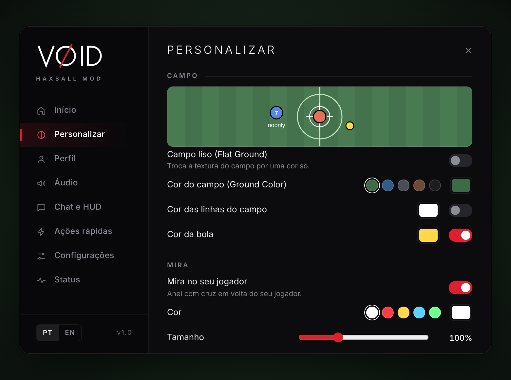

<p align="center">
  
</p>

# VOID HaxBall Mod

HaxBall launcher with its own menu, ad blocking and customization (field, crosshair, sounds, chat, profiles).

<p align="center">
  
</p>

## How to use

1. Download the `.zip` from [Releases](../../releases) and extract the whole folder.
2. Run `VOID-HaxBall-Mod.exe`.
3. `Right Shift` opens and closes the menu.

```
if Windows blocks it: More info -> Run anyway
```

## Run from source

```bash
npm install
npm start
```

## Credits

Developed by **Gabriel Vieira**, with AI assistance (Claude). [MIT](LICENSE) license.

Independent project, not affiliated with HaxBall.
